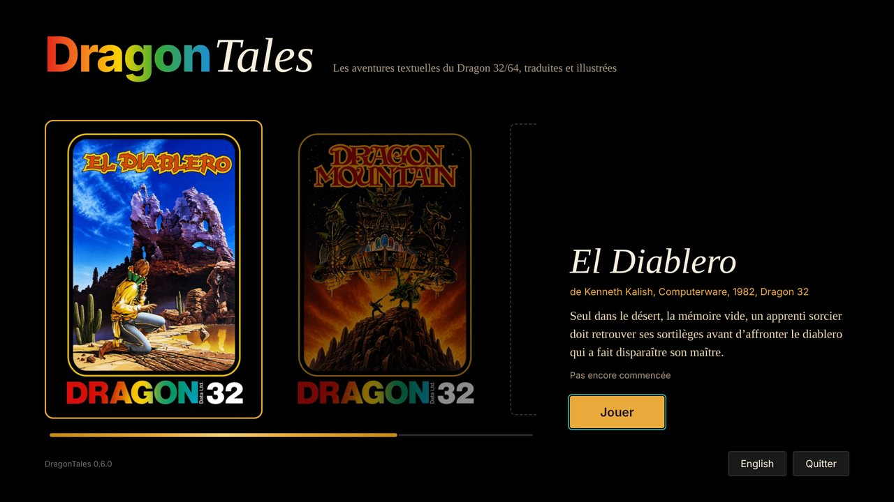
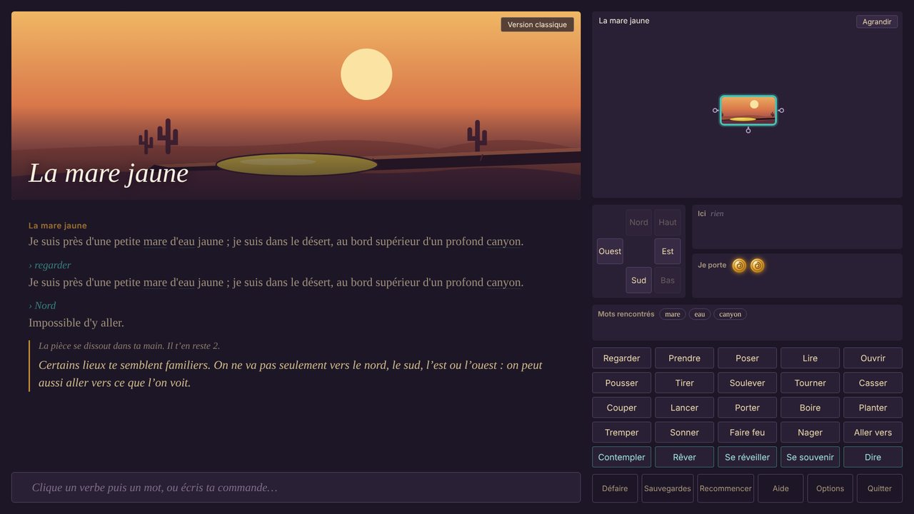
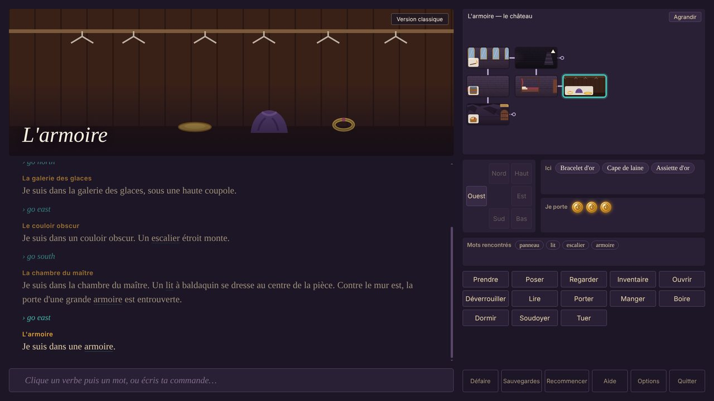

# DragonTales

[](https://github.com/Kraran/DragonTales/actions/workflows/essais.yml)

*[Version française](README.md)*

Old legends, reborn on PC: an engine for replaying Dragon 32/64 text adventures today, translated into French
and illustrated, in a single web page.



The original program of each adventure runs unchanged inside a 6809 emulator written in JavaScript.
DragonTales dresses it up: translated texts, mouse play, a map, illustrations, saved games, hints, music and sound.





## Adventures

| Adventure | Author, publisher | Year | Machine | Languages |
|---|---|---|---|---|
| El Diablero | Kenneth Kalish, Computerware | 1982 | Dragon 32 | French, English |
| Dragon Mountain | Dragon Data | 1982 | Dragon 32 | French, English |

## Play

1. Download `DragonTales-<version>.zip` from the [releases](../../releases) and unzip it.
2. On Windows, run `Jouer.bat`: the page opens full screen in Edge or Chrome, without an address bar.
   Elsewhere, open `DragonTales.html` in a recent browser.

Nothing to install, no connection needed. The interface starts in French; the **English** button on the shelf,
on each title screen and in Options switches everything to English.

Games are saved in the browser; the saved-games window can export them to a file to carry on elsewhere.

## What the engine offers

- **Two versions of every adventure**, switchable during play: modern (16:9, mouse, illustrations) and classic
  (text on a green screen, in the Dragon's typeface).
- **French and English**, switchable at any time: the whole screen and the whole history change language.
- **Mouse play**: a verb, then a word from the text, an object or a direction. Typing commands always works.
- **A map** drawn as you explore, with visible objects and special passages; one click walks you there.
- **Three magic coins** per game: each gives a hint suited to where you are in the adventure.
- **Machine-code or BASIC games**: the original program runs in a 6809 emulator or in a Dragon BASIC interpreter,
  patched when it contains bugs.
- **Saved games** (autosave and three slots, export and import as files), undo, adjustable music and sound effects.

## Build the page

You need Python 3:

```
python build.py
```

`DragonTales.html` is created at the root, next to `Jouer.bat`. The version number comes from the `VERSION` file.

## Layout

```
build.py            builds DragonTales.html
VERSION             version number
Jouer.bat           Windows launcher
moteur/             the engine: 6809 CPU, Dragon machine, BASIC interpreter, shelf and game interface, sounds
aventures/          one folder per adventure (original program, translation, places, drawings, hints, images, music)
tests/              automated tests
outils/             .cas tape extraction, working disassembler, original texts
docs/               documentation (in French), release notes
.github/workflows/  automated tests, release preparation
```

The source code, its comments and the documentation are written in French.
To add an adventure, see [docs/AJOUTER-UNE-AVENTURE.md](docs/AJOUTER-UNE-AVENTURE.md).

## Tests

```
node tests/rejouer-solution.js      # no browser: replays aventures/eldiablero/solution.txt, must end in victory
python build.py
node tests/essai.js                 # in Chrome, with Playwright: shelf, full game, back to the shelf, resume
node tests/sauvegardes.js           # in Chrome: magic coins, kept history, export and import
node tests/essai-dragonmountain.js  # in Chrome: Dragon Mountain (full game, saves, languages, death)
```

The last two need `npm install playwright` and Chrome (set `CHROME` to its path if needed).
GitHub runs all three on every push to `main` and on every pull request.

Warning: the adventures' `solution.txt` files spoil the whole game.

## Credits

- **El Diablero**: original program and texts by Kenneth Kalish, published by Computerware in 1982.
  The binary, the box art and the title-screen art belong to their rights holders.
- **Dragon Mountain**: original program and texts published by Dragon Data in 1982.
  The program and the original box belong to their rights holders.
- Port, French translations, interface, vector illustrations, hints and sound effects: the DragonTales project.
- Music: “Awakening in the Desert” (El Diablero) and “The Guardian's Hoard” (Dragon Mountain), made for this project.
