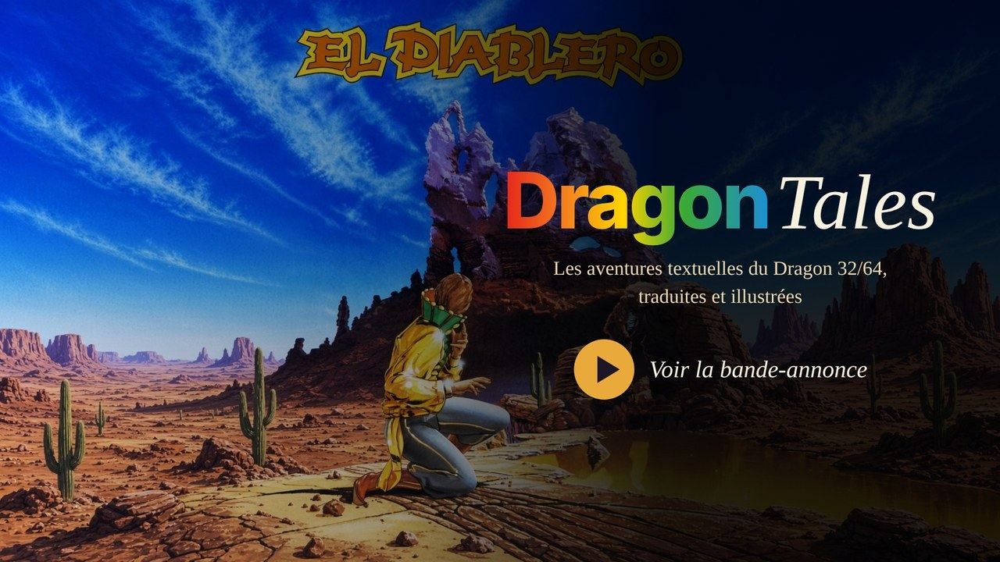
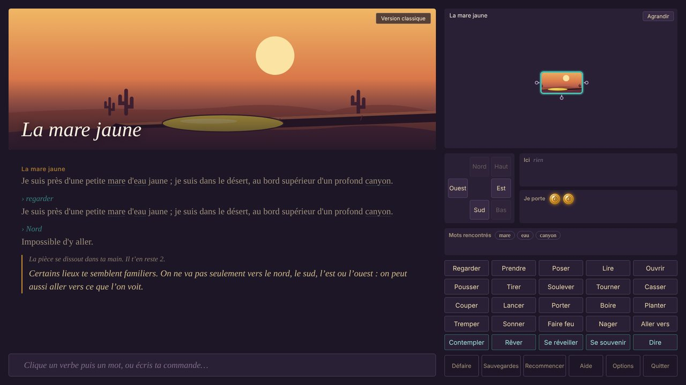
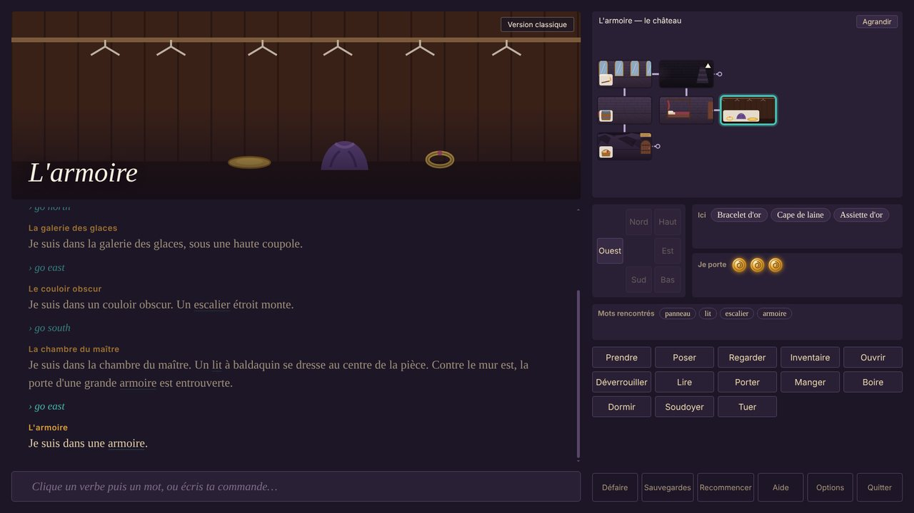
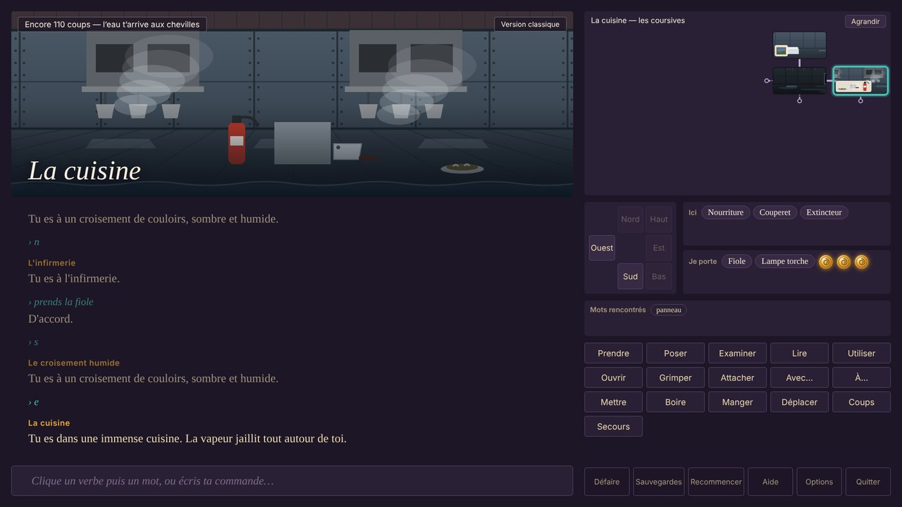
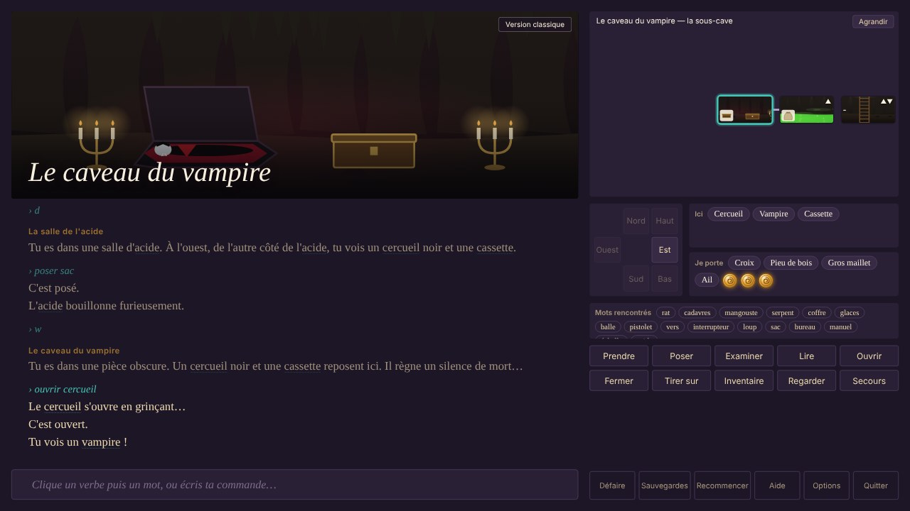
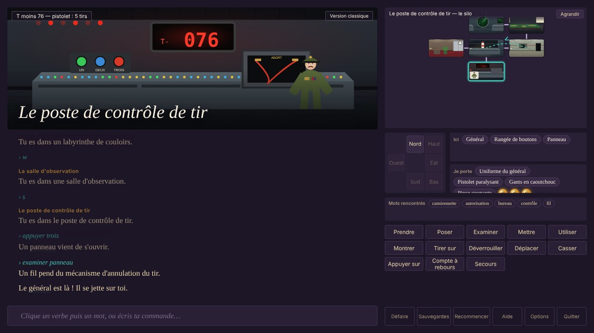

# DragonTales

[](https://github.com/Kraran/DragonTales/actions/workflows/essais.yml)

*[English version](README.en.md)*

Les légendes renaissent sur PC : un moteur pour rejouer aujourd'hui les aventures textuelles du Dragon 32/64,
traduites en français et illustrées, dans une simple page web.

[](https://www.youtube.com/watch?v=p05VqCET59Y)

*[Bande-annonce sur YouTube](https://www.youtube.com/watch?v=p05VqCET59Y) (1 min 17) : clique l'image.*


Le programme d'origine de chaque aventure tourne tel quel dans un émulateur 6809 écrit en JavaScript.
DragonTales l'habille : textes traduits, jeu à la souris, carte, illustrations, sauvegardes, indices, musique et sons.











## Aventures

| Aventure | Auteur, éditeur | Année | Machine | Langues |
|---|---|---|---|---|
| El Diablero | Kenneth Kalish, Computerware | 1982 | Dragon 32 | français, anglais |
| Dragon Mountain | Dragon Data | 1982 | Dragon 32 | français, anglais |
| S.S. Poseidon | Bill et Debbie Cook, Dragon Data | 1982 | Dragon 32 | français, anglais |
| Mansion of Doom | Leroy C. Smith et Paul Austin, Pal Creations / Dragon Data | 1982 | Dragon 32 | français, anglais |
| The Final Countdown | Bill et Debbie Cook, Dragon Data | 1983 | Dragon 32 | français, anglais |

## Jouer

**Dans le navigateur, sans rien télécharger** : sur [itch.io](https://kraran.itch.io/dragontales).

**Sur ton ordinateur, hors ligne** :

1. Télécharge `DragonTales-<version>.zip` dans les [versions](../../releases) et décompresse-le.
2. Sous Windows, lance `Jouer.bat` : la page s'ouvre en plein écran dans Edge ou Chrome, sans barre d'adresse.
   Ailleurs, ouvre `DragonTales.html` dans un navigateur récent.

Rien à installer, aucune connexion nécessaire. Les parties sont sauvegardées dans le navigateur ; la fenêtre
Sauvegardes permet de les exporter dans un fichier pour les reprendre ailleurs.

## Ce que propose le moteur

- **Deux versions de chaque aventure**, entre lesquelles on bascule en cours de partie : la moderne (16/9, souris,
  illustrations) et la classique (texte sur fond vert, police du Dragon).
- **Français et anglais**, changeables à tout moment : tout l'écran et tout l'historique passent dans l'autre langue.
- **Jeu à la souris** : un verbe, puis un mot du texte, un objet ou une direction. On peut toujours écrire ses commandes.
- **Carte** dessinée au fil de l'exploration, avec les objets visibles et les passages particuliers ; un clic y conduit.
- **Trois pièces magiques** par partie : chacune donne un indice adapté à l'endroit où l'on en est.
- **Lecture à voix haute** : dans Microsoft Edge, les réponses du jeu sont lues par les voix neurales de Microsoft
  (Rémy multilingue par défaut) ; voix, vitesse et volume se règlent dans Options.
- **Collection des fins** : chaque mort et la victoire s'ajoutent à la liste de l'aventure, visible sur l'étagère ;
  la fenêtre de fin de partie dresse aussi le bilan (coups joués, lieux découverts, pièces dépensées, temps de jeu).
- **Jeux en code machine ou en BASIC** : le programme d'origine tourne dans un émulateur 6809 ou dans un interpréteur
  Dragon BASIC, corrigé au besoin quand il contient des bugs.
- **Sauvegardes** (automatique et trois emplacements, export et import par fichier), annulation du dernier coup,
  musique et effets sonores réglables.

## Fabriquer la page

Il faut Python 3 :

```
python build.py
```

`DragonTales.html` est créé à la racine, à côté de `Jouer.bat`. Le numéro de version vient du fichier `VERSION`.

## Publier une version

1. Mettre le numéro dans `VERSION`, compléter `CHANGELOG.md` et écrire les notes dans `docs/versions/vX.Y.Z.md`.
2. Sur GitHub, onglet Actions, lancer « Version » (Run workflow) sur `main` — ou pousser l'étiquette : `git tag vX.Y.Z && git push origin vX.Y.Z`.

GitHub assemble alors la page et prépare la version en brouillon avec son archive ; il reste à la relire et à la publier.

## Organisation

```
build.py            assemble DragonTales.html
VERSION             numéro de version
Jouer.bat           lanceur Windows
moteur/             processeur 6809, machine Dragon, interpréteur BASIC, étagère et interface de jeu, sons
aventures/          un dossier par aventure (programme d'origine, traduction, lieux, dessins, indices, images, musique)
tests/              essais automatiques
outils/             extraction d'une cassette .cas, désassembleur de travail, textes d'origine relevés
docs/               documentation, notes des versions
.github/workflows/  essais automatiques, préparation des versions
```

Pour ajouter une aventure : [docs/AJOUTER-UNE-AVENTURE.md](docs/AJOUTER-UNE-AVENTURE.md).

## Essais

```
node tests/rejouer-solution.js      # sans navigateur : rejoue aventures/eldiablero/solution.txt, doit finir par VICTOIRE
python build.py
node tests/essai.js                 # dans Chrome, avec Playwright : étagère, partie entière, retour, reprise
node tests/sauvegardes.js           # dans Chrome : pièces magiques, journal conservé, export et import
node tests/essai-dragonmountain.js  # dans Chrome : Dragon Mountain (partie entière, sauvegardes, langues, mort)
node tests/essai-poseidon.js        # dans Chrome : S.S. Poseidon (niveau, partie entière, écran du Dragon, mort)
node tests/essai-mansion.js         # dans Chrome : Mansion of Doom (partie entière, écrans en couleur, mots de passe, fins)
node tests/essai-finalcountdown.js  # dans Chrome : The Final Countdown (niveau, partie entière malgré le hasard, fins)
node tests/fins.js                  # sans navigateur : la liste des fins de chaque aventure
node tests/essai-fins.js            # dans Chrome : collection des fins et bilan de fin de partie
node tests/essai-voix.js            # dans Chrome : lecture à voix haute (voix d'Edge simulées)
```

Les essais dans Chrome demandent `npm install playwright` et Chrome (variable `CHROME` pour indiquer son chemin).
GitHub lance tous ces essais à chaque modification poussée sur `main` et sur chaque demande de fusion.

Attention : les fichiers `solution.txt` des aventures dévoilent tout le jeu.

## Crédits

- **El Diablero** : programme et textes d'origine de Kenneth Kalish, publiés par Computerware en 1982.
  Le binaire, l'illustration de la boîte et celle de l'écran d'introduction appartiennent à leurs ayants droit.
- **Dragon Mountain** : programme et textes d'origine publiés par Dragon Data en 1982.
  Le programme et la boîte d'origine appartiennent à leurs ayants droit.
- **S.S. Poseidon** (Poseidon Adventure) : programme et textes d'origine de Bill et Debbie Cook, publiés par Dragon Data en 1982.
  Le programme et la boîte d'origine appartiennent à leurs ayants droit.
- **Mansion of Doom** : programme et textes d'origine de Leroy C. Smith et Paul Austin, Pal Creations, diffusés par Dragon Data en 1982.
  Le programme et la boîte d'origine appartiennent à leurs ayants droit.
- **The Final Countdown** : programme et textes d'origine de Bill et Debbie Cook, publiés par Dragon Data en 1983.
  Le programme et la boîte d'origine appartiennent à leurs ayants droit.
- Portage, traductions françaises, interface, illustrations vectorielles, indices et effets sonores : projet DragonTales.
- Musiques : « Awakening in the Desert » (El Diablero) et « The Guardian's Hoard » (Dragon Mountain), créées pour ce projet.
