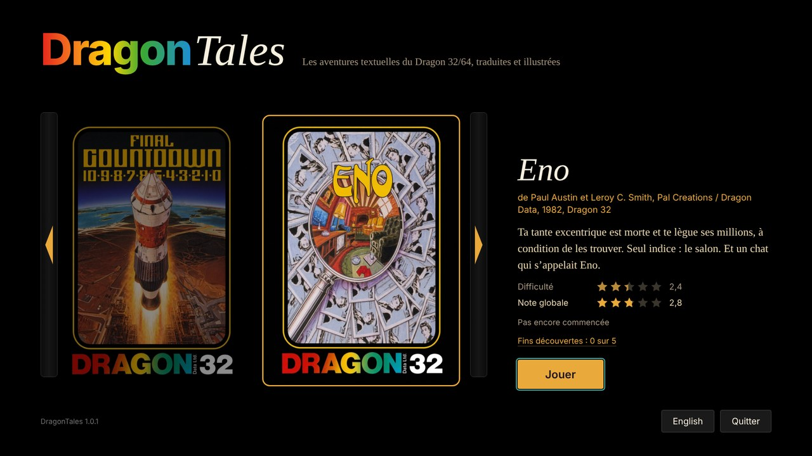

# DragonTales

Les légendes renaissent sur PC : un moteur pour rejouer aujourd'hui les aventures textuelles du Dragon 32/64,
traduites en français et illustrées, dans une simple page web.



Le programme d'origine de chaque aventure tourne tel quel dans un émulateur 6809 écrit en JavaScript.
DragonTales l'habille : textes traduits, jeu à la souris, carte, illustrations, sauvegardes, indices, musique et sons.


## Aventures

| Aventure | Auteur, éditeur | Année | Machine | Langues |
|---|---|---|---|---|
| El Diablero | Kenneth Kalish, Computerware | 1982 | Dragon 32 | français, anglais |

## Jouer

1. Télécharge `DragonTales-<version>.zip` dans les [versions](../../releases) et décompresse-le.
2. Sous Windows, lance `Jouer.bat` : la page s'ouvre en plein écran dans Edge ou Chrome, sans barre d'adresse.
   Ailleurs, ouvre `DragonTales.html` dans un navigateur récent.

Rien à installer, aucune connexion nécessaire. Les parties sont sauvegardées dans le navigateur ; la fenêtre
Sauvegardes permet de les exporter dans un fichier pour les reprendre ailleurs.

## Ce que propose le moteur

- **Deux versions de chaque aventure**, entre lesquelles on bascule en cours de partie : la moderne (16/9, souris,
  illustrations) et la classique (texte sur fond vert, police du Dragon).
- **Français et anglais**, changeables à tout moment : tout l'écran et tout l'historique passent dans l'autre langue.
- **Jeu à la souris** : un verbe, puis un mot du texte, un objet ou une direction. On peut toujours écrire ses commandes.
- **Carte** dessinée au fil de l'exploration, avec les objets visibles et les passages particuliers ; un clic y conduit.
- **Trois pièces magiques** par partie : chacune donne un indice adapté à l'endroit où l'on en est.
- **Sauvegardes** (automatique et trois emplacements, export et import par fichier), annulation du dernier coup,
  musique et effets sonores réglables.

## Fabriquer la page

Il faut Python 3 :

```
python build.py
```

`DragonTales.html` est créé à la racine, à côté de `Jouer.bat`. Le numéro de version vient du fichier `VERSION`.

## Publier une version

1. Mettre le numéro dans `VERSION`, compléter `CHANGELOG.md` et écrire les notes dans `docs/versions/vX.Y.Z.md`.
2. Sur GitHub, onglet Actions, lancer « Version » (Run workflow) sur `main` — ou pousser l'étiquette : `git tag vX.Y.Z && git push origin vX.Y.Z`.

GitHub assemble alors la page et prépare la version en brouillon avec son archive ; il reste à la relire et à la publier.

## Organisation

```
build.py            assemble DragonTales.html
VERSION             numéro de version
Jouer.bat           lanceur Windows
moteur/             processeur 6809, machine Dragon, étagère et interface de jeu, sons
aventures/          un dossier par aventure (programme d'origine, traduction, lieux, dessins, indices, images, musique)
tests/              essais automatiques
outils/             extraction d'une cassette .cas, désassembleur de travail
docs/               documentation, notes des versions
.github/workflows/  préparation automatique des versions
```

Pour ajouter une aventure : [docs/AJOUTER-UNE-AVENTURE.md](docs/AJOUTER-UNE-AVENTURE.md).

## Essais

```
node tests/rejouer-solution.js eldiablero solution.txt     # sans navigateur : doit finir par VICTOIRE
node tests/essai.js solution.txt                           # dans Chrome, avec Playwright (npm install playwright)
node tests/sauvegardes.js                                  # pièces magiques, journal conservé, export et import
```

`solution.txt` est une suite de commandes anglaises séparées par des virgules, après une ligne `START`.
Les solutions ne sont pas fournies dans le dépôt.

## Crédits

- **El Diablero** : programme et textes d'origine de Kenneth Kalish, publiés par Computerware en 1982.
  Le binaire, l'illustration de la boîte et celle de l'écran d'introduction appartiennent à leurs ayants droit.
- Portage, traduction française, interface, illustrations vectorielles, indices et effets sonores : projet DragonTales.
- Musique d'El Diablero : « Awakening in the Desert », créée pour ce projet.
